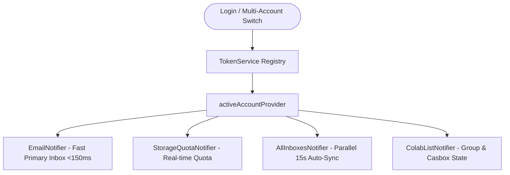

# BNX Mail - Complete API Documentation

> **Comprehensive Technical API & Network Specification for BNX Mail Mobile & Desktop Client**  
> *Generated for Frontend Engineers, Backend Integration, and Cross-Platform Maintenance.*

---

## 📌 1. Global Specifications & Architecture

### 1.1 Base Environment Configuration

- **Production Base URL:** `https://api.bnxmail.com`
- **Development / Local Base URL:** `http://localhost:8080`
- **Environment Variable:** Loaded dynamically at runtime via `flutter_dotenv` from [.env](file:///Users/btrldev004/Desktop/BNX-MAIL-M/.env):

  ```properties
  BASE_URL=https://api.bnxmail.com
  ```

### 1.2 Authentication Scheme

- **Mechanism:** JSON Web Token (JWT) Bearer Authentication.
- **Request Header:**

  ```http
  Authorization: Bearer <accessToken>
  Content-Type: application/json
  Accept: application/json
  ```

- **Multipart Uploads:** For file attachments and avatars, `Content-Type` is omitted in the header configuration to allow the HTTP client to automatically generate the `multipart/form-data; boundary=...` header.

### 1.3 Standard Response Envelope

All primary endpoints return a standard `ApiResponse<T>` wrapper:

#### Success Envelope (`200 OK`, `201 Created`)

```json
{
  "success": true,
  "message": "Operation completed successfully",
  "data": { ... },
  "timestamp": 1712836200000
}
```

#### Error Envelope (`400 Bad Request`, `401 Unauthorized`, `404 Not Found`, `500 Server Error`)

```json
{
  "success": false,
  "message": "Descriptive error message",
  "data": null,
  "timestamp": 1712836200000
}
```

---

## 🔐 2. Client Networking Architecture

### 2.1 Centralized HTTP Engine (`ApiClient`)

Located at [lib/core/network/api_client.dart](file:///Users/btrldev004/Desktop/BNX-MAIL-M/lib/core/network/api_client.dart):

- **Timeout Management:** All standard REST requests have a strict 15-second timeout; multipart and vault uploads are allotted up to 90 seconds.
- **Automatic 401 Token Refresh & Auto-Retry:**
  1. If an authenticated endpoint returns `401 Unauthorized`, `ApiClient` intercepts the failure.
  2. It automatically invokes `POST /api/auth/refresh` using the persistent `refreshToken`.
  3. If token issuance succeeds, the new tokens are persisted via `TokenService`, and the failed request is re-executed once with the fresh token.
  4. If refresh fails, `TokenService.clearTokens()` is called, prompting re-authentication.
- **Uniform Error Parsing:** Throws [ApiException](file:///Users/btrldev004/Desktop/BNX-MAIL-M/lib/core/network/api_exception.dart) with HTTP status codes and user-safe error messages.

### 2.2 Secure Storage & Multi-Account Registry (`TokenService`)

Located at [lib/core/network/token_service.dart](file:///Users/btrldev004/Desktop/BNX-MAIL-M/lib/core/network/token_service.dart):

- **Mobile Devices (Android / iOS):** Uses `FlutterSecureStorage` (EncryptedSharedPreferences on Android, Keychain on iOS).
- **Desktop Environments (macOS / Linux / Windows) & Web:** Direct fallback to persistent local application support files (`.bnx_local_store.json`) to bypass macOS Keychain Developer ID entitlement restrictions (`OSStatus -34018`).
- **Multi-Account Registry (`bnx_saved_accounts_registry`):** Persists multiple email credentials (email, name, accessToken, refreshToken, avatarUrl). Allows switching between accounts in <10ms without losing tokens.

### 2.3 Push Notification Service (`NotificationService`)

Located at [lib/core/notifications/notification_service.dart](file:///Users/btrldev004/Desktop/BNX-MAIL-M/lib/core/notifications/notification_service.dart):

- Integrates Firebase Cloud Messaging (FCM).
- Automatically registers device tokens via `POST /api/users/device-token` on launch/login.
- Automatically revokes tokens via `DELETE /api/users/device-token/{token}` upon logout.

---

## 📑 Complete API Directory by Module

```text
1. Authentication & Onboarding APIs (AuthRepository)
2. User Profile, Mailbox Identities & Sub-IDs (UserRepository)
3. Mail, Folders & Analytics APIs (MailRepository)
4. Casbox: Instant Messaging & Contacts (CasboxRepository)
5. Colab: Group Collaboration & Chat (GroupRepository)
6. Labels & Categories APIs (LabelRepository)
7. Settings & Personalization APIs (SettingsRepository)
8. Storage Quota & Mail Data Vault (StorageRepository & VaultRepository)
9. Reusable Email Templates (TemplateRepository)
10. Subscriptions & Newsletter Blocking (SubscriptionRepository)
11. External Subscriptions & WebSocket Specifications
```

---

## 1. Authentication & Onboarding APIs

Implemented in [auth_repository.dart](file:///Users/btrldev004/Desktop/BNX-MAIL-M/lib/data/repositories/auth_repository.dart).

### 1.1 User Login

Authenticates standard individual users or enterprise sub-ID team members.

- **Method:** `POST`
- **Path:** `/api/auth/login`
- **Auth Required:** No
- **Request Body:**

  ```json
  {
    "email": "user@bnxmail.com",
    "password": "Password123!"
  }
  ```

- **Response (`200 OK`):**

  ```json
  {
    "success": true,
    "message": "Login successful",
    "data": {
      "accessToken": "eyJhbGciOi...",
      "refreshToken": "eyJhbGciOi...",
      "email": "user@bnxmail.com",
      "name": "John Doe",
      "accountType": "INDIVIDUAL",
      "isSubId": false
    }
  }
  ```

### 1.2 Multi-Factor Authentication (2FA) Verification

- **Method:** `POST`
- **Path:** `/api/auth/verify-2fa`
- **Auth Required:** No
- **Request Body:**

  ```json
  {
    "email": "user@bnxmail.com",
    "code": "582910"
  }
  ```

- **Response (`200 OK`):** Same JWT payload as login.

### 1.3 Token Refresh

Refreshes short-lived JWT access tokens.

- **Method:** `POST`
- **Path:** `/api/auth/refresh`
- **Auth Required:** No
- **Request Body:**

  ```json
  {
    "refreshToken": "eyJhbGciOi..."
  }
  ```

- **Response (`200 OK`):**

  ```json
  {
    "success": true,
    "data": {
      "accessToken": "eyJhbGciOi...",
      "refreshToken": "eyJhbGciOi..."
    }
  }
  ```

### 1.4 Individual User Registration

- **Method:** `POST`
- **Path:** `/api/auth/register`
- **Auth Required:** No
- **Request Body:**

  ```json
  {
    "firstName": "Jane",
    "lastName": "Doe",
    "email": "janedoe@bnxmail.com",
    "password": "SecurePassword123!",
    "phoneNumber": "+919876543210",
    "recoveryEmail": "jane.recovery@gmail.com",
    "dob": "1995-08-15"
  }
  ```

### 1.5 Business / Corporate Registration

- **Method:** `POST`
- **Path:** `/api/auth/register-business`
- **Auth Required:** No
- **Request Body:**

  ```json
  {
    "companyName": "Acme Global Technologies",
    "businessType": "Private Limited",
    "companyEmail": "contact@acme.com",
    "password": "AdminPassword123!",
    "cin": "U72200MH2020PTC123456",
    "gstin": "27AABCU9603R1ZM",
    "pan": "AABCU9603R",
    "tan": "MUMB12345E",
    "directors": [
      { "name": "Alice Smith", "din": "01234567" }
    ],
    "address": {
      "street": "100 Tech Boulevard",
      "city": "Mumbai",
      "state": "Maharashtra",
      "pincode": "400001",
      "country": "India"
    }
  }
  ```

### 1.6 Password Reset & Verification Flow

- **Request OTP:** `POST /api/auth/forgot-password` with `{"email": "user@bnxmail.com"}`
- **Verify OTP:** `POST /api/auth/verify-reset-code` with `{"email": "...", "code": "123456"}`
- **Reset Password:** `POST /api/auth/reset-password` with `{"email": "...", "code": "123456", "newPassword": "..."}`
- **Email Availability Check:** `GET /api/auth/check-email?email={email}`
- **Verify PAN / CIN via MCA:** `POST /api/auth/verify-pan` and `POST /api/auth/verify-cin`
- **Fetch Registered GSTINs:** `GET /api/auth/fetch-gstins?pan={panNumber}`

---

## 2. User Profile, Mailbox Identities & Sub-IDs

Implemented in [user_repository.dart](file:///Users/btrldev004/Desktop/BNX-MAIL-M/lib/data/repositories/user_repository.dart).

### 2.1 Get Current User Profile

Retrieves authenticated user details, permissions, storage quota, and active account role.

- **Method:** `GET`
- **Path:** `/api/users/me` (Fallback: `/api/users/settings`)
- **Auth Required:** Yes
- **Response (`200 OK`):**

  ```json
  {
    "success": true,
    "data": {
      "id": 12,
      "username": "johndoe",
      "firstName": "John",
      "lastName": "Doe",
      "email": "johndoe@bnxmail.com",
      "phoneNumber": "+919876543210",
      "recoveryEmail": "john.recovery@gmail.com",
      "accountType": "BUSINESS",
      "role": "OWNER",
      "isSubId": false,
      "avatarUrl": "/api/users/profile-picture/johndoe@bnxmail.com",
      "storageUsed": 1048576,
      "storageLimit": 16106127360
    }
  }
  ```

### 2.2 Update Profile Metadata

- **Method:** `PATCH`
- **Path:** `/api/users/profile` (Fallback: `/api/users/settings`)
- **Auth Required:** Yes
- **Request Body:**

  ```json
  {
    "firstName": "John",
    "lastName": "Smith",
    "phoneNumber": "+919876543210",
    "recoveryEmail": "john.smith@gmail.com"
  }
  ```

### 2.3 Profile Picture (Avatar) Upload & Streaming

- **Upload Avatar:** `POST /api/users/profile-picture`
  - **Payload:** `multipart/form-data` with form field `file` (image bytes).
- **Stream Avatar:** `GET /api/users/profile-picture/{userEmail}`
  - Returns binary image stream (`image/jpeg`, `image/png`).
- **Remove Avatar:** `DELETE /api/users/profile-picture`

### 2.4 Sub-ID Team Management (Enterprise Admin)

Business accounts can provision sub-mailboxes:

- **List All Sub-IDs:** `GET /api/sub-ids` (Fallback: `GET /api/users/sub-accounts`)
- **Create Sub-ID:** `POST /api/sub-ids`
  - **Body:**

    ```json
    {
      "name": "Support Desk",
      "email": "support@company.bnxmail.com",
      "password": "Password123!",
      "role": "MEMBER"
    }
    ```

- **Update Sub-ID Status:** `PATCH /api/sub-ids/{id}/status` with `{"active": true}`
- **Delete Sub-ID:** `DELETE /api/sub-ids/{id}`

### 2.5 FCM Device Token Registration

- **Register Token:** `POST /api/users/device-token` with `{"token": "fcm_token_string", "platform": "macos"}`
- **Unregister Token:** `DELETE /api/users/device-token/{token}`

---

## 3. Mail, Folders & Analytics APIs

Implemented in [mail_repository.dart](file:///Users/btrldev004/Desktop/BNX-MAIL-M/lib/data/repositories/mail_repository.dart).

### 3.1 Fetch Folder Contents

Fetches messages for the specified folder with pagination and limits:

- **Inbox:** `GET /api/mail/inbox?limit={limit}`
- **Sent:** `GET /api/mail/sent?limit={limit}`
- **Drafts:** `GET /api/mail/drafts?limit={limit}` (or `GET /api/mail/draft`)
- **Starred:** `GET /api/mail/starred?limit={limit}`
- **Trash:** `GET /api/mail/trash?limit={limit}`
- **Spam:** `GET /api/mail/spam?limit={limit}`
- **Snoozed:** `GET /api/mail/snoozed?limit={limit}`
- **Archive:** `GET /api/mail/archive?limit={limit}` (or `GET /api/mail/archived`)
- **Scheduled:** `GET /api/mail/scheduled?limit={limit}` (or `GET /api/mail/schedule`)

> **Note on Limits & Global Pagination:** The client requests `limit=1000` by default and dynamically re-requests with the total count if `totalCount > 1000`, guaranteeing that 100% of emails in the folder are fetched and rendered without artificial truncation.

#### Sample Envelope Response

```json
{
  "success": true,
  "data": {
    "emails": [
      {
        "id": "1049",
        "messageId": "<CABe2x=123@mail.bnxmail.com>",
        "sender": "Alice Smith",
        "senderEmail": "alice@bnxmail.com",
        "recipientEmail": "me@bnxmail.com",
        "to": ["me@bnxmail.com"],
        "cc": [],
        "bcc": [],
        "subject": "Quarterly Financial Audit",
        "body": "<p>Please find the audit report attached.</p>",
        "timestamp": 1712836200000,
        "isRead": false,
        "isStarred": true,
        "labels": ["Finance", "Audits"],
        "attachments": [
          {
            "fileName": "Audit_Q1.pdf",
            "fileSize": 2048576,
            "contentType": "application/pdf"
          }
        ]
      }
    ],
    "totalCount": 93
  }
}
```

### 3.2 Single Email Details & Full Body

- **Method:** `GET`
- **Path:** `/api/mail/email/{uid}?folder={folder}`
- **Auth Required:** Yes

### 3.3 Compose & Send Email

- **Method:** `POST`
- **Path:** `/api/mail/send`
- **Payload (`multipart/form-data` or `application/json`):**

  ```json
  {
    "to": ["partner@enterprise.com"],
    "cc": ["manager@bnxmail.com"],
    "bcc": [],
    "subject": "Agreement Proposal",
    "content": "<p>Hello, please review.</p>",
    "isHtml": true,
    "attachments": []
  }
  ```

### 3.4 Schedule Email Sending

- **Method:** `POST`
- **Path:** `/api/mail/schedule?sendAt=2026-11-01T09:00:00Z`
- **Payload:** Same schema as Send Email.
- **Cancel Scheduled Email:** `DELETE /api/mail/scheduled/{id}`

### 3.5 Message State & Lifecycle Actions

- **Star Email:** `POST /api/mail/star/{uid}?folder={folder}`
- **Unstar Email:** `POST /api/mail/unstar/{uid}?folder={folder}`
- **Mark Read:** `POST /api/mail/mark-read/{uid}?folder={folder}`
- **Mark Unread:** `POST /api/mail/mark-unread/{uid}?folder={folder}`
- **Move to Trash:** `DELETE /api/mail/{uid}?folder={folder}`
- **Permanent Delete:** `DELETE /api/mail/permanent/{uid}?folder={folder}`
- **Move to Archive:** `POST /api/mail/archive/{uid}?folder={folder}`
- **Restore from Archive:** `POST /api/mail/unarchive/{uid}?folder={folder}`
- **Snooze Email:** `POST /api/mail/snooze/{uid}?snoozeUntil=2026-10-30T09:00:00Z&folder={folder}`
- **Unsnooze Email:** `POST /api/mail/unsnooze/{uid}?folder={folder}`
- **Empty Trash:** `DELETE /api/mail/empty-trash`

### 3.6 Attachment Streaming & Download

- **Method:** `GET`
- **Path:** `/api/mail/{uid}/attachments/{fileName}?folder={folder}`
- **Response:** Raw binary octet-stream with MIME content disposition.

### 3.7 Mail Activity Analytics

- **Method:** `GET`
- **Path:** `/api/mail/analytics`
- **Response (`200 OK`):**

  ```json
  {
    "totalReceived": 1420,
    "totalSent": 312,
    "unreadCount": 18,
    "spamBlocked": 45,
    "receivedByDate": { "2026-10-27": 14, "2026-10-28": 22 },
    "sentByDate": { "2026-10-27": 8, "2026-10-28": 11 }
  }
  ```

---

## 4. Casbox: Instant Messaging & Contacts

Implemented in [casbox_repository.dart](file:///Users/btrldev004/Desktop/BNX-MAIL-M/lib/data/repositories/casbox_repository.dart).

| No. | Feature | Method | Path | Request Payload / Query Params |
| :--- | :--- | :--- | :--- | :--- |
| **1** | Fetch All Messages | `GET` | `/api/casbox` | None |
| **2** | Fetch Conversation Thread | `GET` | `/api/casbox/thread/{contactEmail}` | Path variable (`contactEmail`) |
| **3** | Send Casbox Message | `POST` | `/api/casbox/send` | `{"receiverEmail": "...", "subject": "...", "body": "...", "attachmentsJson": "[]"}` |
| **4** | Batch Archive Messages | `PATCH` | `/api/casbox/archive` | `{"messageIds": [101, 102], "archived": true}` |
| **5** | Single Message Archive | `PATCH` | `/api/casbox/{id}/archive` | `?archived=true\|false` |
| **6** | Update Delivery/Read Status | `PATCH` | `/api/casbox/status` | `{"messageIds": [101], "status": "SEEN"\|"DELIVERED"}` |
| **7** | Mark Unseen as Delivered | `POST` | `/api/casbox/delivered` | None |
| **8** | Edit Sent Message | `PATCH` | `/api/casbox/{id}` | `{"body": "Corrected text content"}` |
| **9** | Delete Conversation | `DELETE` | `/api/casbox/conversation/{contactEmail}` | Path variable (`contactEmail`) |
| **10** | Get Accepted Connections | `GET` | `/api/connections/accepted` | None |
| **11** | Get All User Connections | `GET` | `/api/connections` | None |
| **12** | Update Connection Status | `PATCH` | `/api/connections/{id}/status` | `{"status": "CONNECTED"\|"DISCONNECTED"}` |
| **13** | Get Contact Aliases | `GET` | `/api/contact-aliases` | None |
| **14** | Set Contact Alias | `PUT` | `/api/contact-aliases/{contactUserId}` | `{"customName": "Alice (CEO Office)"}` |
| **15** | Delete Contact Alias | `DELETE` | `/api/contact-aliases/{contactUserId}` | Path variable |
| **16** | Get Blocked Contacts List | `GET` | `/api/blocked-contacts` | None |
| **17** | Check if Contact is Blocked | `GET` | `/api/blocked-contacts/check` | `?email=target@bnxmail.com` |
| **18** | Block a Contact | `POST` | `/api/blocked-contacts` | `{"email": "spam@bnxmail.com", "reason": "Harassment"}` |
| **19** | Unblock a Contact | `DELETE` | `/api/blocked-contacts/{email}` | Path variable |
| **20** | Get Accepted Senders Whitelist | `GET` | `/api/users/settings` | Parses `casboxAccepted` array |
| **21** | Update Accepted Senders Whitelist | `PATCH` | `/api/users/settings` | `{"casboxAccepted": ["alice@bnxmail.com", "bob@bnxmail.com"]}` |

---

## 5. Colab: Group Collaboration & Chat

Implemented in [group_repository.dart](file:///Users/btrldev004/Desktop/BNX-MAIL-M/lib/data/repositories/group_repository.dart).

### 5.1 Create Group Channel

- **Method:** `POST`
- **Path:** `/api/chat/group`
- **Request Body:**

  ```json
  {
    "name": "Project Apollo",
    "members": ["dev1@bnxmail.com", "dev2@bnxmail.com"]
  }
  ```

### 5.2 Group Navigation & History

- **List User's Groups:** `GET /api/chat/user/{email}`
- **Get Chat Messages:** `GET /api/chat/{chatId}/messages`
- **Send Group Message:** `POST /api/chat/message`  
  *Payload:* `{"chatId": 12, "sender": "me@bnxmail.com", "message": "Ready to launch", "attachmentsJson": "[]"}`
- **Add Members:** `POST /api/chat/{chatId}/members`  
  *Payload:* `{"emails": ["newdev@bnxmail.com"]}`
- **List Members:** `GET /api/chat/{chatId}/members`

### 5.3 Invitations

- **List Pending Invitations:** `GET /api/chat/invitations`
- **Accept Invitation:** `POST /api/chat/invitations/{id}/accept`
- **Reject Invitation:** `POST /api/chat/invitations/{id}/reject`

### 5.4 Announcements & Broadcasts

- **Post Group Broadcast:** `POST /api/chat/{chatId}/broadcast`  
  *Payload:* `{"subject": "Release v2.0 Live", "body": "Deployed to production.", "attachmentsJson": "[]"}`
- **List Broadcasts:** `GET /api/chat/{chatId}/broadcasts`

### 5.5 Channel Settings

- **Rename Group:** `PATCH /api/chat/{id}/name` with `{"name": "New Name"}`
- **Leave Group:** `POST /api/chat/{id}/leave`
- **Delete Group Channel:** `DELETE /api/chat/{id}`

---

## 6. Labels & Categories APIs

Implemented in [label_repository.dart](file:///Users/btrldev004/Desktop/BNX-MAIL-M/lib/data/repositories/label_repository.dart).

- **List Custom Labels:** `GET /api/mail/labels?userEmail={email}`
- **Create Label:** `POST /api/mail/labels?userEmail={email}`  
  *Payload:* `{"name": "Urgent", "color": "#E11D48"}`
- **Update Label:** `PUT /api/mail/labels/{id}?userEmail={email}`  
  *Payload:* `{"name": "High Priority", "color": "#F43F5E"}`
- **Delete Label:** `DELETE /api/mail/labels/{id}?userEmail={email}`
- **Apply Label to Email:** `POST /api/mail/labels/apply/{uid}?labelId={id}&folder={folder}&userEmail={email}`
- **Remove Label from Email:** `DELETE /api/mail/labels/remove/{uid}?labelId={id}&folder={folder}&userEmail={email}`
- **Category Filter:** `GET /api/mail/category/{category}`  
  *Valid categories:* `primary`, `social`, `promotions`, `updates`.

---

## 7. Settings & Personalization APIs

Implemented in [settings_repository.dart](file:///Users/btrldev004/Desktop/BNX-MAIL-M/lib/data/repositories/settings_repository.dart).

### 7.1 General Settings

- **Get All Settings:** `GET /api/users/settings`
- **Update Settings (Partial):** `PATCH /api/users/settings`  
  *Payload:* `{"undoSendDelay": 10, "autoAdvance": "newer", "themeMode": "dark"}`

### 7.2 Language, Typography & Composing Preferences

- **Language:** `GET /api/settings/language` | `PUT /api/settings/language` (`{"language": "en"}`)
- **Composing Assist:** `GET /api/settings/composing` | `PUT /api/settings/composing`  
  *Payload:* `{"spellingCheckEnabled": true, "grammarCheckEnabled": true, "autoCorrectEnabled": true, "smartComposeEnabled": true}`
- **Typography:** `GET /api/settings/text-style` | `PUT /api/settings/text-style`  
  *Payload:* `{"fontFamily": "Roboto", "fontSize": "Normal", "textColor": "#000000"}`
- **Wallpaper Theme:** `GET /api/settings/wallpaper` | `PUT /api/settings/wallpaper` | `POST /api/settings/wallpaper/reset`

### 7.3 Email Signatures

- **List Signatures:** `GET /api/signatures`
- **Create Signature:** `POST /api/signatures`  
  *Payload:* `{"name": "Corporate", "content": "<p>Best regards,<br><b>John</b></p>", "isDefault": true}`
- **Update Signature:** `PUT /api/signatures/{id}`
- **Delete Signature:** `DELETE /api/signatures/{id}`
- **Set Default Signature:** `PATCH /api/signatures/{id}/default`

### 7.4 Two-Factor Authentication (2FA / TOTP)

1. **Initiate 2FA Setup:** `POST /api/users/2fa/setup`  
   *Response:* `{"data": {"secret": "JBSWY3DPEHPK3PXP", "qrCodeUri": "otpauth://totp/BNXMail:user?secret=..."}}`
2. **Verify & Enable:** `POST /api/users/2fa/verify`  
   *Payload:* `{"code": "123456"}`
3. **Disable 2FA:** `POST /api/users/2fa/disable`

---

## 8. Storage Quota & Mail Data Vault

Implemented in [storage_repository.dart](file:///Users/btrldev004/Desktop/BNX-MAIL-M/lib/data/repositories/storage_repository.dart) and [vault_repository.dart](file:///Users/btrldev004/Desktop/BNX-MAIL-M/lib/data/repositories/vault_repository.dart).

### 8.1 Real-Time Mailbox Storage Quota

- **Method:** `GET`
- **Path:** `/api/mail/storage-quota`
- **Auth Required:** Yes
- **Response (`200 OK`):**

  ```json
  {
    "success": true,
    "data": {
      "email": "user@bnxmail.com",
      "storageLimit": 16106127360,
      "storageUsed": 2147483648,
      "storagePercentage": 13.33
    }
  }
  ```

### 8.2 Mail Data Vault (Cloud Backups & Exports)

- **List Vault Files:** `GET /api/vault`  
  *Response items:* `id`, `filename`, `contentType`, `size`, `createdAt`.
- **Upload Backup File:** `POST /api/vault/upload`  
  *Content-Type:* `multipart/form-data` with form field `file` (`.zip`, `.eml`, `.mbox`, `.pdf`, etc.).
- **Download File Stream:** `GET /api/vault/{id}/download`  
  *Response:* Binary stream with original MIME type and content disposition.
- **Delete Vault File:** `DELETE /api/vault/{id}`

---

## 9. Reusable Email Templates

Implemented in [template_repository.dart](file:///Users/btrldev004/Desktop/BNX-MAIL-M/lib/data/repositories/template_repository.dart).

- **List Templates:** `GET /api/templates?userEmail={email}`
- **Create Template:** `POST /api/templates?userEmail={email}`  
  *Request Body:*

  ```json
  {
    "name": "Meeting Follow-Up",
    "subject": "Follow-Up: Our Discussion Today",
    "content": "Hi {{name}},\n\nThank you for your time today...",
    "category": "Business"
  }
  ```

- **Update Template:** `PUT /api/templates/{id}?userEmail={email}`
- **Delete Template:** `DELETE /api/templates/{id}?userEmail={email}`

---

## 10. Subscriptions & Newsletter Blocking

Implemented in [subscription_repository.dart](file:///Users/btrldev004/Desktop/BNX-MAIL-M/lib/data/repositories/subscription_repository.dart).

- **Get Blocked & Unsubscribed Senders:** `GET /api/blocked-contacts`
- **Unsubscribe & Block:** `POST /api/mail/unsubscribe?senderEmail={email}`  
  *(Automatic fallback to `POST /api/blocked-contacts` with `{"email": "..."}`)*
- **Resubscribe & Unblock:** `POST /api/mail/subscribe?senderEmail={email}`  
  *(Automatic fallback to `DELETE /api/blocked-contacts/{encodedEmail}`)*
- **Check Subscription Status:** `GET /api/blocked-contacts/check?email={email}`

---

## 11. External Subscriptions & WebSocket Specifications

### 11.1 Cliks Business Billing Plan (External Partner Service)

The account billing screen fetches external plan subscriptions from:

- **Method:** `GET`
- **Endpoint:** `https://cliks.beta-softnet.com/api/v1/business/subscription/{userEmail}`
- **Auth Required:** No
- **Response (`200 OK`):**

  ```json
  {
    "success": true,
    "data": {
      "plan_name": "Enterprise Pro Plan",
      "subscription_days_remaining": 64,
      "when_subscribed": "2026-09-01T10:00:00Z",
      "next_due_date": "2026-12-31T23:59:59Z",
      "email": "user@bnxmail.com"
    }
  }
  ```

### 11.2 Real-Time WebSocket Specifications (Casbox & Live Messaging)

- **Transport Protocol:** STOMP over WebSocket or SockJS
- **Handshake Endpoint:** `wss://api.bnxmail.com/ws` (or `ws://<host>:8080/ws`)
- **Headers:** `Authorization: Bearer <accessToken>`
- **Subscribed Private User Channels:**
  - `/user/{userEmail}/queue/casbox/messages` — Inbound instant messages and multi-device sync.
  - `/user/{userEmail}/queue/casbox/receipts` — Live delivery and read receipt status broadcasts.
- **Client Fallback:** If WebSocket disconnected, the Flutter application maintains active conversation state using a 3-second background polling cycle.

---

## 12. Client State Architecture & Lifecycle

The app uses **Flutter Riverpod** with isolated account caching:



1. **Fast-Hydration Architecture:** Primary `Inbox` loads in parallel and displays in under 150ms, while secondary folders (`Sent`, `Trash`, `Archive`, etc.) hydrate asynchronously in the background.
2. **Unified All-Inboxes Engine:** `AllInboxesNotifier` aggregates inbox streams from all saved multi-account registry tokens in parallel, providing a unified chronologically sorted inbox.
3. **Session Interceptor:** In-flight token refreshes deduplicate requests to prevent concurrent redundant calls to `/api/auth/refresh`.
